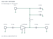

# Радиотелескоп на линии водорода 1420,406 МГц

## Малошумящий усилитель · ревизия A1



[Электрическая схема EAGLE](hardware/LNA.sch) · [Плата EAGLE](hardware/LNA.brd) · [Вид сверху](hardware/layout.svg)

Пара SCH/BRD в формате Autodesk EAGLE XML 9.6, символы и посадочные места встроены. Открывать файлы парой. Векторный вид платы показывает монтаж, сигнальные дорожки и отверстия. Реальную форму заливок рассчитывает САПР.

| Поз. | Деталь | Кол. |
|---|---|---:|
| U1 | Qorvo SPF5189Z, SOT-89, фланец на землю | 1 |
| C1 | 10 пФ C0G, 0603 | 1 |
| C2, C3 | 100 пФ C0G, 0603 | 2 |
| C4 | 100 нФ X7R, 0603 | 1 |
| L1 | 47 нГн, 0603, ВЧ, от 120 мА. Ориентир Toko LL1608-FSL47N | 1 |
| J1, J2 | Отрезки 50-омного RG316 с подходящими SMA на свободных концах | 2 |
| J3 | Пара проводов питания | 1 |

Рупор → J1 → усилитель → J2 → SDR. У коаксиала контакт 1 — жила, 2 — оплётка. Оставить открытые участки жилы короткими. Закрепить кабели на корпусе. J3.1 — внешние стабилизированные +5 В, J3.2 — земля. В SDR отключить bias tee (запуск rtl_sdr без -T).

Плата 30 × 25 мм, FR-4, два слоя, целевая толщина 0,8 мм, медь 35 мкм. Нижняя сторона — земля. Переходные отверстия металлизированные, сверло 0,35 мм. На входном и выходном участках ширина 1,4 мм. Для заданного стеклотекстолита это начальная геометрия. Перед изготовлением уточнить у изготовителя диэлектрическую проницаемость и толщину диэлектрика и проверить импеданс с учётом верхней заливки. Входной и выходной кабели вывести с противоположных сторон экрана.

Схема использует номиналы из примера на 1900 МГц. Геометрия платы своя. [Паспорт SPF5189Z и пример разводки](https://sdrshop.nl/wp-content/uploads/SPF5189-Data-Sheet.pdf).

## Проверка

1. Открыть SCH и BRD в САПР, пересчитать полигоны, выполнить ERC и DRC по ограничениям выбранного производства. Проверить ноль неразведённых цепей, зазор по контуру, шелкографию и распечатку посадочного места U1 в масштабе 1:1.
2. После пайки проверить отсутствие КЗ по питанию. Завершить RF-порты нагрузками 50 Ом, подать 5 В с ограничением 120 мА. Типичный ток около 90 мА. Проверить отсутствие постоянного напряжения на выходе.
3. Проверить S21 на 1420 МГц и спектр с нагрузкой на входе при закрытом экране. Для измерения коэффициента шума нужен отдельный калиброванный эксперимент. Затем сравнить фон земли и неба при фиксированном усилении SDR.

Ревизия A1 — проект первого прототипа. Программно сверены принадлежность контактов цепям схемы и платы и совпадение концов проводов схемы с выводами. Производственные проверки САПР и измерения физического экземпляра предстоят. Генерация исходников и рисунков — python -B hardware/draw_lna.py.

## Обработка наблюдений

Установить NumPy. Обе записи — interleaved unsigned 8-bit IQ из rtl_sdr с одинаковыми настройками, по умолчанию 1420 МГц и 2,4 Мвыб/с. Запуск из каталога проекта:

```powershell
python spectrum.py on.iq off.iq
```

В spectrum.csv записываются частота в МГц и превышение мощности над опорным небом в процентах.
