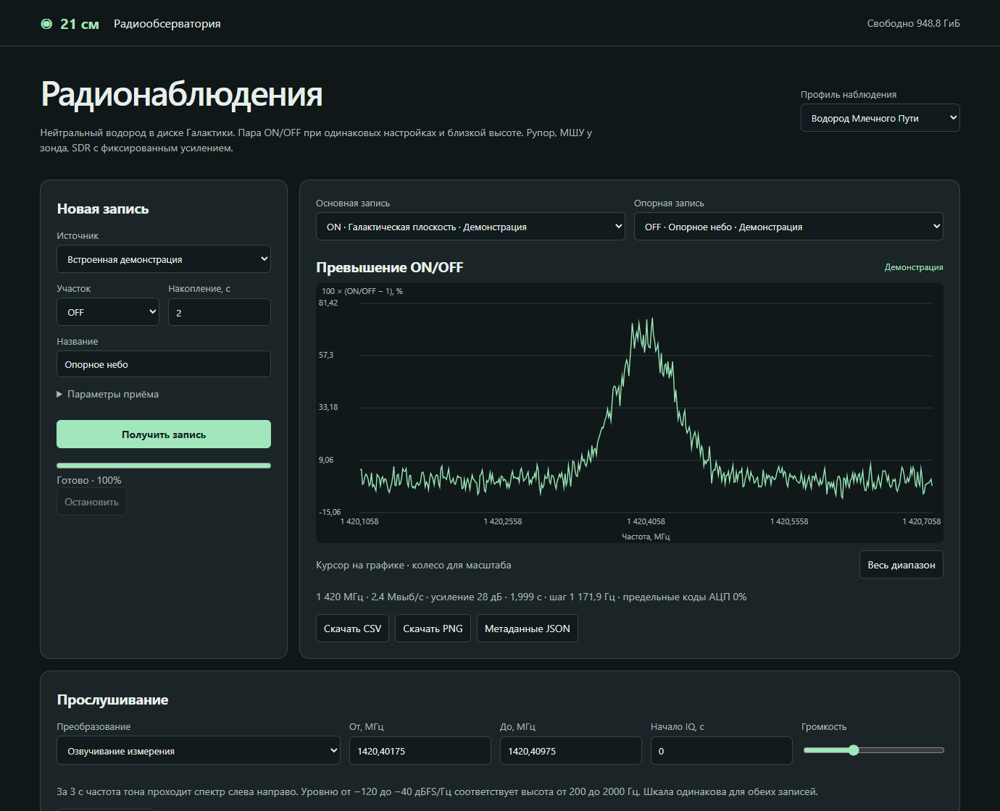

# Радиотелескоп на линии водорода · 1420,40575 МГц

Самодельный рупор 500 × 400 мм принимает излучение Млечного Пути. Усилитель SPF5189Z у зонда передаёт сигнал в RTL-SDR Blog V3, Linux-сервер записывает IQ, а браузер показывает спектр и разность ON/OFF. Для первого запуска программы достаточно встроенного демонстратора.

**Статус A2.** Электрическая схема и плата прошли ERC, DRC и сверку соединений в KiCad 10.0.8. Производственные файлы экспортированы. Docker и браузер проверены на синтетических данных. Усиление платы, согласование рупора и повторяемость небесного наблюдения предстоит измерить на собранном экземпляре. [Протокол проверок](docs/verification.md) · [Инженерный отчёт](reports/Приём%20галактического%20водорода.md)

## Комплект проекта

| Материал | Файлы |
|---|---|
| Схема и плата усилителя | [Проект KiCad с локальными библиотеками](hardware/LNA.kicad_pro) · [схема](hardware/LNA.kicad_sch) · [читаемый экспорт](hardware/schematic-kicad.svg) · [плата](hardware/LNA.kicad_pcb) · [монтаж](hardware/layout.svg) · [EAGLE SCH](hardware/LNA.sch) / [BRD](hardware/LNA.brd) |
| Изготовление | [Gerber, Excellon и карта сверления](hardware/fabrication/) · [стек, монтаж и стендовый протокол](hardware/RF.md) · [ERC](hardware/checks/erc.rpt) · [DRC и соответствие платы](hardware/checks/drc.rpt) |
| Антенна и крепление | [Размерный сборочный чертёж](antenna/assembly.svg) · [раскрой 1:1 и инструкция](antenna/README.md) · [модель седла OpenSCAD](antenna/cable-saddle.scad) · [STL](antenna/cable-saddle.stl) |
| Полный приёмник | [Соединения от зонда до USB](docs/receiver.svg) · [расчёт тракта и критерии выбора фильтра](docs/receiver.md) |
| Закупка и планирование | [Ведомость с продавцами, сметы, инструменты и сроки](docs/budget.md) · [журнал решений](docs/decisions.md) |
| Сборка и первое небо | Маршрут ниже · [стендовые испытания](hardware/RF.md) · [земля–небо, Млечный Путь, Солнце](docs/observing.md) |
| Веб-приложение | [Запуск, USB, сеть и HTTPS](docs/server.md) · [Compose](compose.yaml) · [пример конфигурации](.env.example) · [профили](web/profiles.json) · [проверки в Chrome](docs/browser-checks.md) |

## От закупки до первого наблюдения

1. **Выберите комплект.** Минимальная конфигурация оценивается в **22 478,83 ₽**, расширенная с полосовым фильтром — **28 828,83 ₽**. Сервер и принтер уже имеются. Сверьте наличие оригинального V3 и SPF5189Z, возьмите на время приборы для наладки. Сопоставьте DFM фабрики и стек с [параметрами платы](hardware/RF.md).
2. **Пока идут платы, соберите рупор и разверните приложение.** Ножницы по жести, линейка и угольник нужны для раскроя. Перед резкой измерьте контрольную линейку на шаблоне. Проверьте размеры горловины, проводимость швов, положение зонда и отражение. Если минимум S11 смещён, подберите длину зонда по [механической инструкции](antenna/README.md).
3. **Смонтируйте и испытайте усилитель.** Проверьте голую плату мультиметром, припаяйте U1 с фланцем, развязку и кабели. Первое включение выполните от лабораторного БП с ограничением 120 мА при двух нагрузках 50 Ом. Ориентир тока — 90 мА. Измерьте DC на выходе, S-параметры и отсутствие самовозбуждения. Для каждой неисправности действия приведены в [таблице приёмки](hardware/RF.md).
4. **Подключите SDR.** Проверьте полярность питания, выключенное питание bias tee, доступ к USB из контейнера и короткую пробную запись. Для 5 с при 2,4 Мвыб/с ожидаются 24 МБ CU8. Сравните уровни при двух ручных усилениях. Если форма спектра зависит от ослабления или появляются комбинационные пики, примените [проверку перегрузки](docs/receiver.md).
5. **Проверьте землю и небо, затем измерьте объект.** Начните с области Лебедя на галактическом экваторе. Запишите OFF–ON–OFF на близких высотах и с одинаковым усилением. Повторите серию со смещённым центром SDR. Проверяйте признак в абсолютных радиочастотах, отмечайте помехи, повторите наблюдение в другой день. Критерии приёмки, точность и состав журнала даны в [полевой инструкции](docs/observing.md).

Для владельца готового проекта оценка составляет **12–24 чел·ч** сборки, наладки и первого наблюдения, плюс **1–3 чел·ч** настройки сервера. Разработка и проверка комплекта с нуля — **52–88 чел·ч**. Календарный ориентир — **7–10 недель** с поставкой микросхемы либо **2–4 недели** при местном наличии U1 и SDR.

## Веб-приложение за несколько минут

Из корня проекта на Linux:

```sh
cp .env.example .env
docker compose up -d --build
```

**Адрес на сервере — http://127.0.0.1:8080/**. Для браузера на другом устройстве укажите в .env LAN-адрес сервера в LISTEN_IP и повторите `docker compose up -d`. Например, сервер с адресом 192.168.1.20 будет доступен по http://192.168.1.20:8080/. [Инструкция по запуску и передаче одного USB-устройства](docs/server.md)

Выберите «Водород Млечного Пути» → «Встроенная демонстрация». Создайте запись ON и затем OFF. Выберите первую как основную, вторую как опорную. На спектре появится широкое превышение около 1420,406 МГц. Сохраните CSV или PNG, затем нажмите «Подготовить звук» и сравните два проигрывателя. В режиме «Принятый шум» слышен перенесённый в звуковую область участок IQ. В режиме «Озвучивание измерения» высота тона следует уровню спектра.



Исходный консольный сценарий сохранён для обработки двух файлов одинаковой настройки. Команда `python spectrum.py on.iq off.iq` с установленным NumPy создаёт spectrum.csv. Параметры задаются через `--center` и `--rate` в герцах. Веб-приложение дополнительно проверяет метаданные, показывает маски и сохраняет результаты наблюдения.
