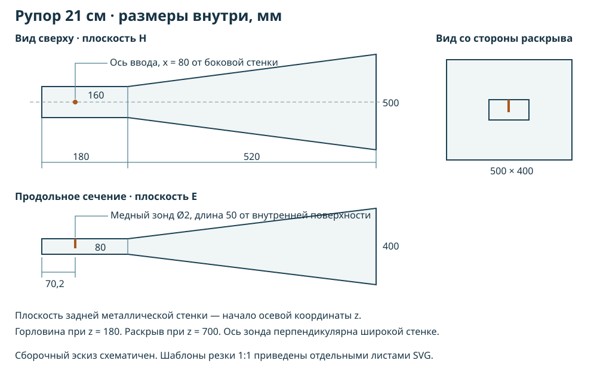

# Пирамидальный рупор с одним линейным зондом

**Все размеры в миллиметрах.** Целевые внутренние размеры горловины 160 × 80, прямого участка 180, раскрыва 500 × 400, расстояние горловина–раскрыв 520. Дно закрыто металлом. Цель при сборке ±1 мм для горловины и оси зонда, ±3 мм для раскрыва. Линейная поляризация вдоль зонда.

## Раскрой листа

Лужёная жесть 0,25–0,40 мм, например 2 листа 1000 × 1000. Резать в перчатках ножницами по металлу, снять заусенцы. Детали плоские, без интегральных загибов. Допуск на толщину такого листа укладывается в допуск сборки. Узкие стенки входят между широкими. Внутренний размер задаёт деревянный съёмный шаблон. Напечатать шаблоны 100 % без подгонки и проверить линейкой отметку 100 мм. На бытовом принтере разбить большие листы на страницы с совмещением меток. Исходные контуры генерирует [make_patterns.py](make_patterns.py).

| Деталь | Кол. | Геометрия контура |
|---|---:|---|
| [Широкая панель](flare-wide.svg) | 2 | Равнобедренная трапеция 160 → 500, высота в плоскости 544,06 |
| [Узкая панель](flare-narrow.svg) | 2 | Равнобедренная трапеция 80 → 400, высота в плоскости 547,08; точный размер на шаблоне |
| [Стенка с зондом](guide-probe.svg) | 1 | 160 × 180, отверстие Ø4,1, центр в 80 от боковой кромки и 70,2 от дна |
| [Противоположная стенка](guide-wide.svg) | 1 | 160 × 180 |
| [Боковина](guide-narrow.svg) | 2 | 80 × 180 |
| [Дно](back.svg) | 1 | 160 × 80 |
| Наружные нахлёстки | комплект | Полосы шириной 20, по 10 нахлёста на каждую панель. 4 × 571 для углов раструба (подрезать по месту), 4 × 180 для углов горла, 4 × 160 и 4 × 80 для поперечного стыка и дна |
| Кромка раскрыва | комплект | П-образный пластиковый кант либо окантовка из ленты снаружи. Длина 1,8 м |

Боковая кромка обеих трапеций одна и та же: √(520² + 160² + 170²) = 570,0 мм с округлением. Раскладка на каждом листе: широкая трапеция в полосе шириной 500, узкая в соседней шириной 400, оставшиеся стенки и дно помещаются ниже, полосы нахлёсток вырезать до мелких деталей. Не добавлять 10 мм к основному контуру — этот припуск уже обеспечивают отдельные полосы.

## Сборка

1. **Каркас.** Разметить на фанере шаблон сечением 160 × 80 и временную рамку по внутреннему раскрыву 500 × 400. Угольником проверить углы, разность диагоналей раскрыва ≤4 мм. Проверить линейкой расстояние между плоскостями 520. При перекосе ослабить прихватки.
2. **Швы.** Обезжирить, зачистить 10 мм каждой кромки до металла, предварительно облудить. Нахлёстки согнуть вдоль под фактическим углом по шаблону. Прихватить стенки, затем пропаять швы непрерывно, короткими чередующимися участками во избежание коробления. Следовать инструкции флюса и смыть активный остаток. Для оцинкованной или алюминиевой конструкции потребуется отдельная технология контакта. Вынуть шаблоны до установки дна. Отдельно проверить каждый шов щупами мультиметра с обнулёнными проводами (ориентир <0,2 Ом) и под свет на отсутствие щелей. Омметр выявляет обрыв, ВЧ-качество проверяет VNA.
3. **Переход.** В отверстие снаружи впаять латунную трубку Ø4, длина 8, внутренний диаметр под лужёный экран RG316 (~2,2, проверить образец). Внутренний конец заподлицо. На наружном конце пигтейла установить кабельную SMA-маму для RG316, к ней подключить SMA-папу входного хвоста платы. Снять оболочку на длину трубки, ввести кабель до плоскости стенки, опаять экран по окружности снаружи, сохранить PTFE изоляцию центральной жилы. Коротко припаять медный прямой штырь Ø2 к центральной жиле. Ось перпендикулярна широкой стенке, выступающий металл 50 от внутренней плоскости, включая место пайки. Смонтировать усилитель непосредственно снаружи, длина пигтейла желательно ≤0,15 м. Прозвонить сигнал от SMA до конца штыря, корпус до стенки, между штырём и стенкой должен быть разрыв. Удалить случайный мостик или оборванную оплётку до подключения.
4. **Опора.** Две деревянные V-образные поперечины на общей рейке охватывают рупор снаружи при z=90 и z=510 от дна. Подложить полосы резины, удерживать двумя нейлоновыми ремнями шириной от 20. Ширина сечения в этих местах 160 и ~376, высота 80 и ~283. Уширить опоры, если жесть проминается. Сторону с зондом оставить свободной. Установить рейку на устойчивую поворотную вилку или регулируемые козлы, уравновесить с кабелем; измерять угол оси приложенным к рейке угломером после определения поправки между рейкой и осью. Вне помещения закрепить от опрокидывания ветром.
5. **Кабель.** [Седло OpenSCAD](cable-saddle.scad) и [STL, мм](cable-saddle.stl) ставятся на деревянную рейку рядом с пигтейлом, вне волновода. PETG, слой 0,2, сопло 0,4, 4 периметра, 30 % заполнения, плоским основанием вниз. Проход поперечной стяжки 4,5 × 2,3, допускает мост без поддержек. Крепления Ø3,4 в координатах (5;5) и (33;17) от угла основания 38 × 22. Шурупы 3 × 12, предварительные отверстия по породе дерева. Оставить свободную петлю, стяжка 3,6 не должна пережимать кабель.
6. **ВЧ-проверка.** Отсоединить усилитель. Калибровать VNA (SOL) у конца измерительного кабеля со стороны SMA рупора. Навести на свободное небо, собрать S11 1350–1500 МГц, принять при S11 ≤ −10 дБ в 1419,5–1421,0 МГц. При промахе сперва проверить швы, ориентацию зонда и соединение оплётки. Изготовить сменные штыри длиной 46–54 с шагом 2 и сравнить кривые в одной геометрии. Записать выбранную длину и кривую. Изменять по одному параметру.

## Расчёт и границы применимости

В воздушном прямоугольном волноводе TE10 имеет отсечку c/(2a) = 937 МГц. Для TE20 и TE01 ближайшая отсечка 1874 МГц. На 1420,40575 МГц λ₀ = 211,06 мм и λg = λ₀ / √(1 − (937/1420,41)²) ≈ 280,8 мм. Исходные 70,2 мм до короткозамыкателя равны четверти λg; четверть λ₀ для штыря равна 52,8 мм. Стартовые 50 мм учитывают открытый конец приближённо. Диаметр зонда, припой, диэлектрик и раструб влияют на согласование; подтверждение требует S11.

Площадь раскрыва 0,20 м². При проектном КПД апертуры 0,40–0,60 эффективная площадь 0,08–0,12 м², усиление по 4πAэфф/λ² около 13,5–15,3 dBi. Ориентир для планирования по ширине главного лепестка H ≈ 67λ/W ≈ 28°, E ≈ 56λ/H ≈ 30°. Действительная диаграмма и КПД нуждаются в измерении. Снять два взаимно перпендикулярных солнечных прохода и определить ширину на половине приращения мощности.

