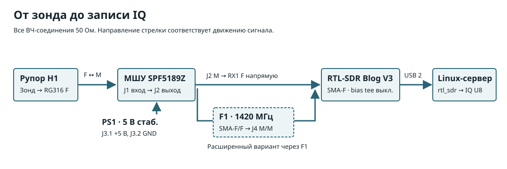

# Приёмник на 1420,40575 МГц

У горловины установить экранированный модуль LNA. Оплётку кабеля зонда соединить с металлической стенкой по окружности, кабель закончить SMA-F. На вход J1 платы припаять хвост SMA-M. На J1/J2 площадка 1 — центральная жила, 2 — оплётка. J2 со своим SMA-M подключить прямо к SMA-F донгла, механически разгрузить его USB и SMA. В расширенном варианте J2 входит в SMA-F фильтра, от его другого SMA-F к донглу идёт пигтейл J4 M/M. Корпус соединить с землёй коротко у кабельных вводов, выход и вход вывести на разные стороны. Рупор, усилитель и SDR для первого сеанса находятся в сухом месте рядом с USB-портом сервера. Удалённую антенну с многометровым тонким коаксиалом следует пересчитать отдельно.

Питание PS1 подвести отдельной парой к J3.1 (+5 В) и J3.2 (GND). Замерить напряжение на плате под нагрузкой, целевое 5,0 В, падение на проводах ≤0,1 В. Обвязка отделяет постоянный ток на выходе конденсатором C2. При первом включении ограничить ток источника до 120 мА. Перед присоединением SDR проверить на J2 напряжение постоянного тока мультиметром с подключенной нагрузкой 50 Ом, ориентир <10 мВ. Отключить bias tee у SDR, при неизвестном состоянии обесточить и заново подключить донгл, проверить у SMA отсутствие питания. Фильтр GPIO Labs допускает максимум 3 В DC на порте, поэтому его включать после проверки. [Паспорт V3](https://www.rtl-sdr.com/wp-content/uploads/2018/02/RTL-SDR-Blog-V3-Datasheet.pdf) · [Паспорт фильтра](https://gpio.com/products/1420-mhz-bandpass-filter)

### Частота, оцифровка и запуск Linux

Выбран USB-A вариант **RTL-SDR Blog V3**, R860/R820T2 + RTL2832U, SMA-F, вход 50 Ом, TCXO 1 ppm, 8-битный АЦП. Паспортная верхняя граница 1766 МГц покрывает линию, производитель указывает устойчивую полосу до 2,4 МГц. Начать с 2,4 Мвыб/с, центра 1420,000 МГц, ручного усиления ближайшей поддерживаемой ступени около 20 дБ. 1 ppm на этой частоте даёт около 1,42 кГц. Указать фактические усиление, время UTC, температуру и поправку частоты в журнале. По изменению несущей внешнего опорного генератора после прогрева проверить остаточное смещение. Для проверки небесной природы линии повторить пару ON/OFF с центром 1420,800 МГц при том же усилении: линия переходит из +405,75 в −394,25 кГц относительно центра. Сравнивать пары после перевода в абсолютную частоту. [Паспорт и начальное отклонение TCXO](https://www.rtl-sdr.com/wp-content/uploads/2018/02/RTL-SDR-Blog-V3-Datasheet.pdf)

Поддержка V3 подтверждается паспортом, пакет Debian содержит консольные программы rtl_test и rtl_sdr. У V3 не требуется сетевой SDR-службы или драйвера в браузере. В контейнер передаётся ровно USB-узел выбранного приёмника (путь /dev/bus/usb по lsusb, режим rw), процессу даётся GID группы, имеющей право чтения/записи этого узла на хосте. После переподключения сверить новый номер узла. Если ядро удерживает устройство драйвером DVB, освободить его на хосте согласно инструкции производителя. Команда самостоятельной приёмки — `rtl_test -s 2400000` **из того же контейнера и под тем же UID/GID**, при остановленной записи: обнаружение R820T/2 и отсутствие повторяющихся lost bytes за 60 с, затем Ctrl+C. USB-захват остаётся пунктом выездного протокола до реального испытания. [Пакет Debian](https://packages.debian.org/bookworm/rtl-sdr) · [Настройка Linux](https://www.rtl-sdr.com/rtl-sdr-quick-start-guide/)

### Бюджет шума у горловины

Все цифры ниже — **проектная модель** с температурой пассивных элементов 290 K и согласованными портами. Использованы потери до МШУ 0,30 дБ (до 225 мм RG316 и переход), собственный NF усилителя 0,90 дБ, усиление 16 дБ, посткабель 0,30 дБ и эффективный NF тюнера 6 дБ на выбранной ручной ступени. Последние три параметра уточняются измерением. У Belden RG316 при 1,5 ГГц 36,5 дБ/100 ft, около 1,2 дБ/м. Пять метров того же кабеля до LNA дадут около 6 дБ потерь и более 850 K собственного эквивалентного шума одного фидера. [Belden](https://catalog.belden.com/index.cfm?event=pd&p=PF_83284) · [Qorvo](https://www.qorvo.com/products/p/SPF5189Z)

Для линейных коэффициентов потерь L₁ перед LNA и L₂ после него, шум-факторов Fₐ и Fᵣ, усиления Gₐ: F = L₁ × [Fₐ + (L₂×Fᵣ − 1)/Gₐ], Tᵣ = 290 × (F − 1). В F входят кабели, дополнительный фильтр входит в L₂. Температура антенны, засветка земли и диссипативные потери рупора учитываются отдельно при переходе к Tсист.

| Путь | Уровень на входе тюнера относительно зонда | Расчётный NF тракта | Tᵣ у зонда |
|---|---:|---:|---:|
| J2 → SDR, короткие кабели | +15,4 дБ | 1,48 дБ | 118 K |
| J2 → F1 → J4 → SDR, F1 −3 дБ и J4 −0,3 дБ | +12,1 дБ | 1,87 дБ | 156 K |

Эффект расширенного варианта — устойчивость к внеполосным блокирующим сигналам. У фильтра GPIO Labs типичные потери 3 дБ в полосе и ослабление около 24 дБ на 1300 и 1600 МГц. Для такой помехи отношение полезного сигнала к блокирующему на входе тюнера улучшается примерно на 21 дБ. Для помехи внутри рабочей полосы выигрыша нет. До установки измерить S21 фильтра с теми же разъёмами в диапазоне 1419–1422 МГц и на частотах фактических источников. При наличии генератора/анализатора также проверить отсутствие компрессии тракта. [GPIO Labs](https://gpio.com/products/1420-mhz-bandpass-filter)

### Выбор конфигурации по измерению

1. **Проверить динамический диапазон.** В течение 30 с снять небо, затем нагрузку 50 Ом с теми же настройками. Для каждого массива исходных байтов U8 проверить гистограмму. Рабочий ориентир доли значений 0 или 255 — менее 0,01% при обеих нагрузках. Значительные хвосты у границ — повод снизить усиление; отсутствие клиппинга ещё допускает аналоговую компрессию. Сохранить данные при двух ступенях тюнера с разницей около 6 дБ.
2. **Проверить, нужен ли F1.** Повторить записи с фильтром после LNA, затем снова без него, не меняя направления. Сравнить контраст земля/небо и амплитуды побочных пиков относительно локального фона. Исчезновение «гребёнки» и более стабильный контраст при том же ручном усилении поддерживают использование F1. Если снижение усиления SDR и постфильтр не устраняют комбинированные составляющие, временно установить F1 *перед* LNA (использовать подходящие короткие SMA-переходы). Если улучшение проявляется лишь в этом положении, вероятна перегрузка первого каскада. Трёхдецибельный предфильтр при 290 K сам добавляет примерно 289 K и удваивает шумовую температуру последующего тракта. Для постоянной установки искать менее шумный участок или фильтр с меньшими входными потерями.
3. **Проверить необходимость второго каскада.** На длинной линии или при малом измеренном S21 первого модуля оценить вклад (L₂×Fᵣ−1)/Gₐ. Для минимального короткого тракта он даёт около 26 K у зонда; удвоение числа каскадов само по себе не удваивает чувствительность. При потерях после первого каскада в 6 дБ и тех же параметрах вклад тюнера с фидером уже около 116 K. В этом случае проверить второй экранированный каскад после фильтра **перед длинной линией**, снизив усиление тюнера. Сравнить повторные чередования ON/OFF с ним и без него. Оставить каскад, только если сигнал/разброс растёт больше межсерийного разброса в трёх парах и тесты на перегрузку и самовозбуждение остаются чистыми. Такой вариант требует дополнительных платы, БП или увеличенного запаса по току, корпуса и переходов. В штатной смете он не выбран.
